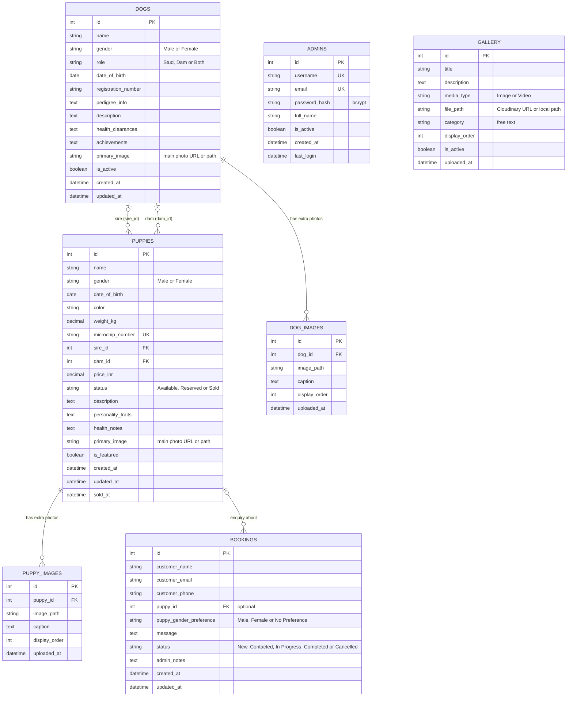

# Entity-Relationship Diagram

The tables below are the ones created by the Flask models in `backend/models/` (via `db.create_all()`), which is what the production database uses. `docs/schema.sql` is an optional hand-written SQL version; see [Models vs schema.sql](#models-vs-schemasql).

## Diagram



## Relationships

### 1. Dogs → Puppies (two optional links, one-to-many each)

- Each puppy can point to a **sire** and a **dam**, both rows in `dogs`:
  - `puppies.sire_id → dogs.id`
  - `puppies.dam_id → dogs.id`
- Both are optional, so a puppy can have 0, 1 or 2 parents recorded.
- **On delete:** `SET NULL`. Deleting a dog keeps its puppies.
- One dog can be the parent of many puppies.

### 2. Dogs → Dog_Images (one-to-many)

- `dog_images.dog_id → dogs.id`
- **On delete:** `CASCADE`. Deleting a dog deletes its extra images.
- The dog's **main photo is stored in `dogs.primary_image`**. `dog_images` holds additional photos, ordered by `display_order`.

### 3. Puppies → Puppy_Images (one-to-many)

- `puppy_images.puppy_id → puppies.id`
- **On delete:** `CASCADE`.
- The puppy's **main photo is stored in `puppies.primary_image`**. `puppy_images` holds additional photos, ordered by `display_order`.

### 4. Puppies → Bookings (optional one-to-many)

- `bookings.puppy_id → puppies.id`, nullable.
- A booking with no puppy is a general enquiry.
- **On delete:** `SET NULL`. Deleting a puppy keeps the booking.

### 5. Gallery (independent)

- No foreign keys.
- `category` is free text (default `General`) with no database constraint. The admin form currently offers `puppies`, `dogs`, `facility` and `activities`.

### 6. Admins (independent)

- No foreign keys. Content is not linked to the admin who created it.
- Passwords are stored as bcrypt hashes in `password_hash`.

## Constraints

### Allowed values (CHECK constraints)

```
dogs.gender:                        'Male', 'Female'
dogs.role:                          'Stud', 'Dam', 'Both'
puppies.gender:                     'Male', 'Female'
puppies.status:                     'Available', 'Reserved', 'Sold'
gallery.media_type:                 'Image', 'Video'
bookings.status:                    'New', 'Contacted', 'In Progress', 'Completed', 'Cancelled'
bookings.puppy_gender_preference:   'Male', 'Female', 'No Preference' (or NULL)
```

### Unique constraints

- `admins.username`
- `admins.email`
- `puppies.microchip_number`

(`dogs.registration_number` is **not** unique.)

### Email format check

- Applied to `admins.email` and `bookings.customer_email` (PostgreSQL regex).

## Indexes

The models define one explicit index (`admins.username`). PostgreSQL also creates indexes automatically for primary keys and unique constraints. No other indexes are created by the models.

For the current data size (dozens of rows) this makes no practical difference. If the data grows, add indexes such as:

```sql
CREATE INDEX idx_puppies_status  ON puppies(status);
CREATE INDEX idx_dogs_role       ON dogs(role);
CREATE INDEX idx_gallery_category ON gallery(category);
CREATE INDEX idx_bookings_created ON bookings(created_at DESC);
```

These indexes (and more, including partial ones) are already written in `docs/schema.sql`, but they exist in a database only if you run that file.

## Data integrity rules

### Cascade deletes

- Delete a dog → its `dog_images` rows are deleted.
- Delete a puppy → its `puppy_images` rows are deleted.

### Historical data kept

- Delete a dog → its puppies stay, with `sire_id` or `dam_id` set to NULL.
- Delete a puppy → its bookings stay, with `puppy_id` set to NULL.

### Timestamps

- `created_at` is set when the row is inserted.
- `updated_at` (dogs, puppies, bookings) is refreshed by SQLAlchemy's `onupdate` when the app updates a row. It is **not** a database trigger, so edits made directly in SQL do not change it.
- `sold_at` is set by the application when a puppy's status changes to `Sold`.

### Image files

- In production, image columns hold full Cloudinary URLs. In local development they hold relative paths such as `puppies/photo.jpg`.
- Deleting a dog, puppy or gallery item should also delete the file, either from Cloudinary or from `backend/uploads/`.

## Sample data flow

### Adding a new puppy

```
1. Admin creates the puppy (basic info + main photo)  → INSERT into puppies (primary_image set)
2. Admin adds extra photos                             → INSERT into puppy_images
3. The puppy appears on the public Puppies page
4. A visitor submits the booking form                  → INSERT into bookings (status 'New')
5. Admin updates the booking and marks the puppy       → status 'Reserved'
6. When sold                                           → status 'Sold', sold_at set
```

### Querying available puppies with their parents

```sql
SELECT
    p.id, p.name, p.gender, p.price_inr,
    sire.name AS father_name,
    dam.name  AS mother_name
FROM puppies p
LEFT JOIN dogs sire ON p.sire_id = sire.id
LEFT JOIN dogs dam  ON p.dam_id  = dam.id
WHERE p.status = 'Available'
ORDER BY p.date_of_birth DESC;
```

## Design decisions

### Why a primary image column plus separate image tables?

- The list pages only need one photo, so `primary_image` avoids a join.
- The `*_images` tables allow extra photos with captions and an order.

### Why optional parent references?

- Some puppies may not have both parents in the system.
- Puppies can be added before the parent records exist.
- Parents may retire or be removed without losing the puppy records.

### Why no public user accounts?

- Visitors don't log in. Bookings are simple enquiries with the customer's contact details.
- Only the `admins` table exists, for the kennel owner.

### Why status values as constrained text?

- The database rejects invalid values.
- Filtering by status is simple.
- Each value maps to a clear business state.

## Models vs schema.sql

Two sources describe the schema:

- **`backend/models/*.py`** is what the running app and the production database use. Treat it as the source of truth.
- **`docs/schema.sql`** is a hand-written SQL version. It includes extra indexes and `updated_at` triggers that the models do not create.

If you change a model, update `schema.sql` and this document too, or they will drift apart. Note that `db.create_all()` does not alter existing tables, so changing a model does not change a database that already exists. For changes after launch, write the `ALTER TABLE` statements (or adopt a migration tool such as Flask-Migrate).

---

**Schema version**: 1.1
**Last updated**: October 2026